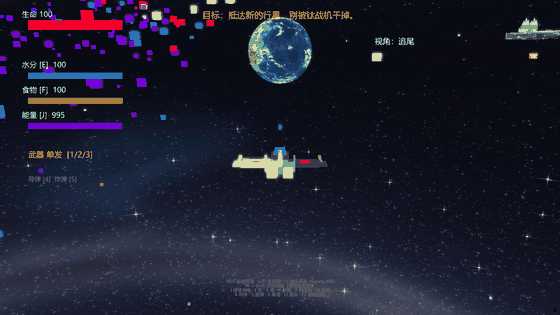
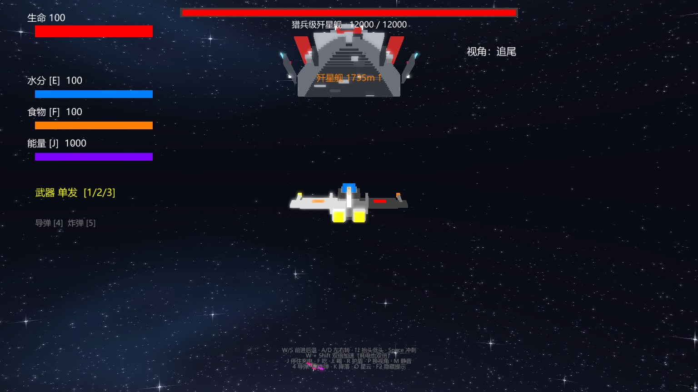
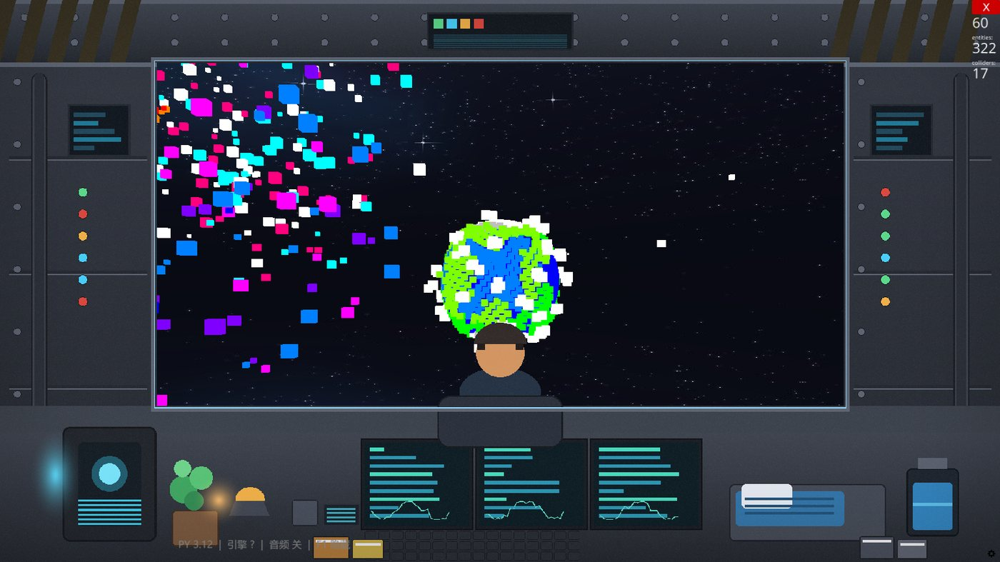
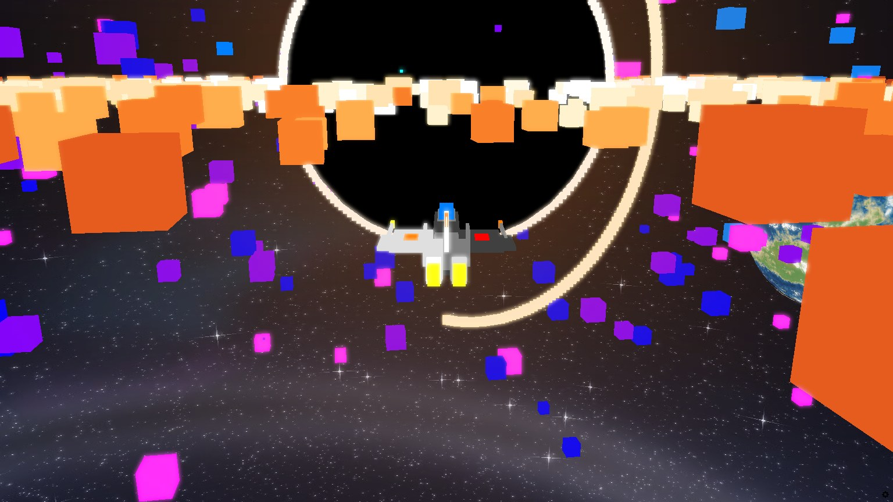

# STELLAR SIEGE 3D · 星际围攻 3D

一个用 **Python + Ursina + Panda3D** 写的单人太空飞行射击游戏。母星被死星炮击后，你驾驶战机冲进银河，穿越星云、击伤歼星舰，最后做出选择：降落新世界，还是把船开进黑洞。

<h2 align="center"><a href="https://github.com/JasonHui81/stellar-siege-3d/releases/latest/download/StellarSiege3D-Portable.zip">⬇ 立即下载 星际围攻 3D（Windows 64 位 · 119.6 MB）</a></h2>

<p align="center">
  <a href="https://jasonhui81.github.io/stellar-siege-3d/"></a>
  <a href="https://github.com/JasonHui81/stellar-siege-3d/releases"></a>
  
</p>



**任何人都能直接下**：不需要 GitHub 账号、不需要登录、不需要装 Python。点上面的按钮，浏览器就开始下载；解压后双击「启动游戏.bat」（或进 `game` 文件夹双击 `Stellar Siege 3D.exe`）即可开玩。

<p align="center">
    
</p>

## 三步开玩

1. **下载**：点上面的「立即下载」，得到 `StellarSiege3D-Portable.zip`（119.6 MB）
2. **解压**：解压到硬盘任意位置（不要在压缩包里直接双击运行）
3. **启动**：双击 `启动游戏.bat`，等几秒就进游戏；也可以进 `game` 文件夹双击 `Stellar Siege 3D.exe`

打不开时用 `启动游戏-调试.bat`，它会保留命令行窗口把报错显示出来。

## 最新版本 v75

- 新增独立启动器 `Stellar Siege 3D.exe`（不依赖 bat，双击直接进游戏）
- 游戏内「设置」可切换中英文界面
- 屏幕下方常驻按键提示，不会操作也能照着按

## 游戏内容

- 6 个结局、3 种视角（追尾 / 第一人称 / 驾驶舱内景）
- 程序化银河全景（4096×2048，5 万+ 颗星，纯代码生成）
- 20 个音效 + 循环 BGM，全部由代码合成，零第三方素材
- 生存系统：HP / 能量 / 口渴 / 饥饿 / 等级 / 护盾 / 导弹 / 炸弹
- Boss 是猎兵级歼星舰，配三座会瞄准你的炮台，加钛战机与拦截机编队

## 从源码运行

```bash
pip install ursina panda3d pygame-ce pillow
python stellar_siege_3d.py
```

源码：[`stellar_siege_3d.py`](stellar_siege_3d.py)

## 操作

| 按键 | 作用 |
|------|------|
| W / S | 前进 / 倒退（消耗能量） |
| A / D | 左右偏航 |
| ↑ / ↓ | 抬头 / 低头 |
| W + Shift | 双倍加速（耗电也双倍） |
| 鼠标左键 | 开火 |
| 1 / 2 / 3 | 单发 / 三连散射 / 高速连射 |
| 空格 | 冲刺（带无敌帧）；片头中 = 跳过片头 |
| J | 悬停充能 |
| Q / E / F | 治疗 / 喝水 / 进食 |
| R | 护盾；结算画面 = 重开 |
| P | 切换视角 |
| 4 / 5 | 导弹 / 炸弹 |
| K | 降落星球 |
| O | 星云附近 = 进黑洞；其他位置 = 暂停 |
| M / F2 / ESC | 静音 / 显示隐藏提示 / 退出 |

## 配置要求

| 项 | 要求 |
|------|------|
| 系统 | Windows 10 / 11 64 位 |
| 显卡 | 支持 OpenGL（集显也可以） |
| 磁盘 | 约 280 MB（解压后） |
| 网络 | 只需下载时需要 |

## 制作

| 角色 | 人 |
|------|----|
| 玩法设计 · 关卡与结局 · 试玩找 Bug | 许智皓 |
| 程序 · 体素建模 · 音效合成 · 打包 | DeepSeek（AI 编程助手） |

引擎：Python 3.14 + Ursina 8.3 + Panda3D 1.10　｜　音效：全部程序化合成

## 说明

这个游戏用的是桌面 3D 引擎（Ursina / Panda3D），**浏览器里跑不了**，所以只能下载到 Windows 上玩。作品免费分发，非商业发行。
